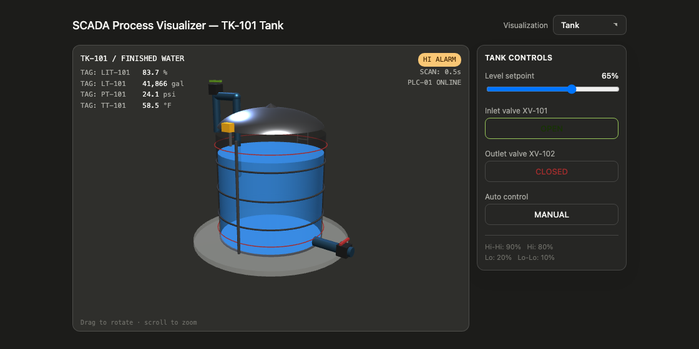

# Tauri Tank Demo



[](https://github.com/mattcurf/tauri-play/actions/workflows/build.yml)

A Tauri 2 desktop app hosting a Vite, TypeScript, and Three.js SCADA storage tank simulation.
Rust is used as the Tauri shell only; the simulation, HMI controls, and WebGL scene all run in
the frontend.

This project is open source under the [Apache License 2.0](LICENSE). Contributions are welcome;
see [CONTRIBUTING.md](CONTRIBUTING.md) for the development workflow and
[SECURITY.md](SECURITY.md) for vulnerability reporting.

## Project Status

This repo is a small desktop/WebGL demo, not a production SCADA system or industrial-control
reference implementation.

- Use it as a Tauri, TypeScript, and Three.js example.
- Do not connect it to live process equipment.
- Do not treat the simulated telemetry, alarms, control modes, or graphics as validated process
  safety logic.
- Review Tauri configuration, signing, update distribution, dependency licensing, and platform
  packaging before using it as the base for a production desktop app.

## Implemented Scope

- Tauri 2 shell with no custom Rust IPC commands.
- Vite and TypeScript frontend.
- Three.js r128 tank scene with the TK-101 shell, liquid level, inlet and outlet piping, pump,
  motor, impeller, flow arrows, alarm rings, HMI tags, and orbit controls.
- In-browser process simulation loop driven by `requestAnimationFrame`.
- HMI controls for level setpoint, inlet/outlet state, and automatic mode.
- Host-native desktop packaging through Tauri for macOS and Windows in CI.

## Deliberate Out-Of-Scope Items

- No real PLC, OPC UA, MQTT, Modbus, historian, or database integration.
- No backend state persistence.
- No authentication, authorization, or operator audit trail.
- No notarized release artifacts in the default workflow.
- No auto-update channel.

## Prerequisites

- Node.js 20+ and npm.
- Rust stable via `rustup`.
- Platform-specific Tauri system dependencies.

<details><summary>Windows</summary>

- Visual Studio 2022 Build Tools with the Desktop development with C++ workload.
- WebView2 Runtime. It is preinstalled on Windows 11 and may need separate installation on some
  Windows 10 systems.
- Rust via rustup: <https://rustup.rs>
- Node.js 20+: <https://nodejs.org>

</details>

<details><summary>macOS</summary>

- Xcode Command Line Tools: `xcode-select --install`
- Rust via rustup: `curl --proto '=https' --tlsv1.2 -sSf https://sh.rustup.rs | sh`
- Node.js 20+: `brew install node`

</details>

## Run The App

From this repository directory:

```bash
npm install
npm run tauri dev
```

`npm run tauri dev` starts the Vite dev server and opens the tank demo in a native Tauri desktop
window.

If you only want to run the frontend in a browser, use:

```bash
npm install
npm run dev
```

Then open <http://127.0.0.1:1420/>.

## Local Checks

Run the lightweight checks before opening a pull request:

```bash
npm run build
cd src-tauri
cargo fmt --check
cargo check --locked
```

For a full local desktop bundle:

```bash
npm run tauri build
```

Tauri builds host-native artifacts: `.app`/`.dmg` on macOS and `.msi`/`.exe` on Windows.
Cross-compilation is not used.

On macOS the app bundle is ad-hoc signed so locally built `.app` bundles can launch without the
"damaged" invalid-signature error. It is not notarized; for distribution outside your machine,
sign with a Developer ID certificate and notarize the build.

### macOS Gatekeeper Troubleshooting

If you trust a locally built or CI-downloaded app and macOS still reports that it is damaged or
cannot be opened, clear the quarantine attribute for just that app:

```bash
APP="/Applications/Tauri Tank Demo.app"
xattr -dr com.apple.quarantine "$APP"
open "$APP"
```

For an app downloaded from a GitHub Actions artifact, also repair executable permissions and
refresh the ad-hoc signature if needed:

```bash
APP="$HOME/Downloads/Tauri Tank Demo.app"
chmod +x "$APP/Contents/MacOS/tauri-tank-demo"
codesign --force --deep --sign - "$APP"
xattr -dr com.apple.quarantine "$APP"
open "$APP"
```

Avoid `sudo spctl --master-disable`; it disables Gatekeeper globally. Prefer clearing quarantine
only on an app you trust.

## CI And Release Artifacts

The GitHub Actions workflow in `.github/workflows/build.yml` builds macOS and Windows desktop
artifacts on pushes to `main`, pull requests, and manual dispatches.

- macOS: ad-hoc signed `.app` bundle plus `.dmg`.
- Windows: NSIS `.exe` installer plus `.msi`.
- Artifacts are not Apple notarized or store-signed by default.

Before publishing a release, decide whether to add platform signing, macOS notarization,
provenance/SBOM generation, and a release-channel policy.

## Security Notes

The current app loads only local bundled frontend assets and does not define custom Tauri IPC
commands. The Tauri content security policy is intentionally explicit in `src-tauri/tauri.conf.json`.

If you add remote content, Tauri plugins, filesystem access, shell access, update distribution, or
external process integration, update `SECURITY.md`, the CSP, and Tauri capability scopes in the
same change.

Do not commit signing certificates, private keys, `.env` files, API tokens, platform-store
credentials, or generated release secrets. The `.gitignore` includes common local and signing
credential patterns.

## License Notes

The original project code in this repository is licensed under Apache 2.0. Dependencies resolved
through npm and Cargo remain subject to their own upstream license terms.

See [THIRD_PARTY_NOTICES.md](THIRD_PARTY_NOTICES.md) for direct dependency license notes.
